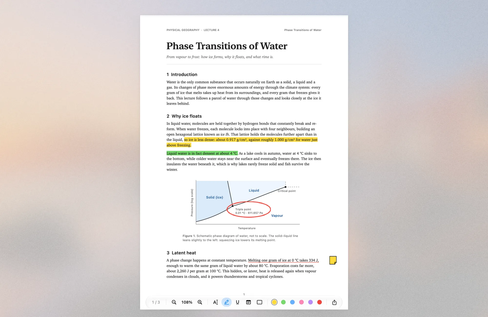
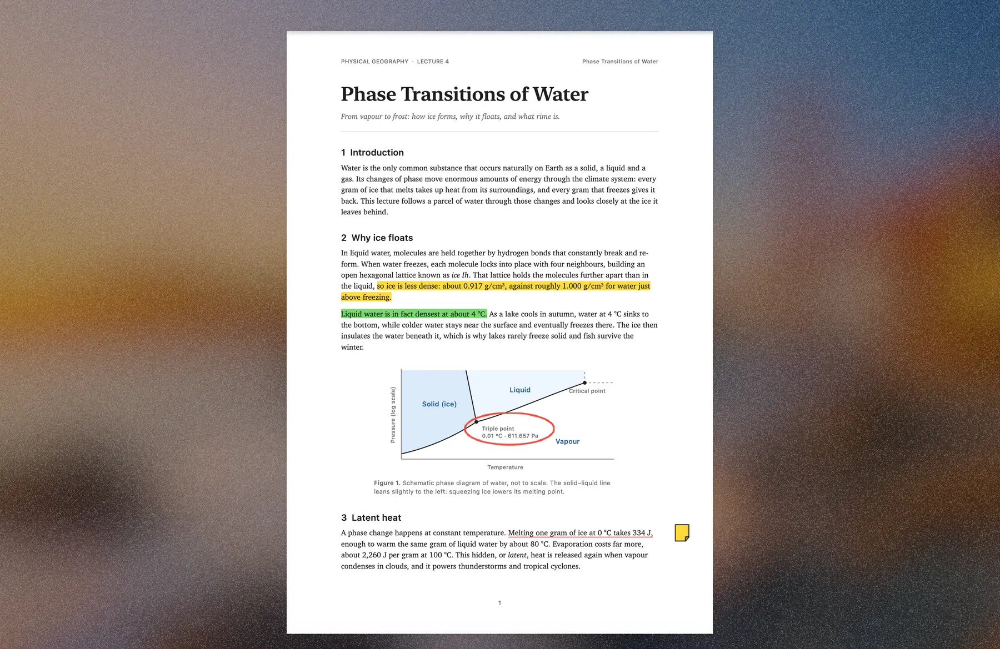
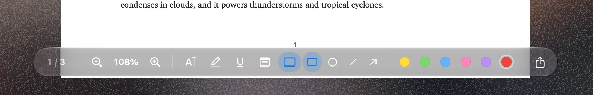

# Rime

[](https://yorben.me/#rime)
[](https://github.com/Yvsleyen00941/homebrew-tap)
[](LICENSE)
[](https://swift.org)
[](https://yorben.me/#rime)

A PDF reader for studying, where only the page is left. Everything around it
freezes over into frosted ice: the desktop and its widgets, the icons, the Dock
and the menu bar.



## What it does

- **Frost from your wallpaper.** The ice is your own desktop picture, blurred,
  brightened and given a fine grain, so it always matches your Mac.
- **It freezes and melts.** Ice grows in from the edges of the screen when you
  open a PDF, and melts away when you switch to another app.
- **Reading like Preview.** It's PDFKit underneath, so pinch, smart zoom,
  scrolling and text selection work exactly as you're used to.
- **Markup other apps understand.** Highlight, underline, notes, rectangles,
  ovals, lines and arrows, in six colours, saved as standard PDF annotations.
  Rime autosaves like Preview, with full undo.
- **Controls that step aside.** A Liquid Glass capsule holds the page number,
  zoom, tools and colours. It fades when the mouse rests and when you scroll.
- **Menu bar and Dock:** hidden while you read, or kept visible, in Settings.
  The pages always stay clear of the notch.
- **Export** the PDF with its markup, or the current page as PNG or JPEG.
- Follows **Dark Mode**, and respects **Reduce Motion** and **Reduce
  Transparency**.

| Freezing in | Dark Mode |
|---|---|
|  |  |



## Keyboard

| Keys | Does |
|---|---|
| ⌘O | Open a PDF |
| ⌘+ ⌘− | Zoom in, zoom out |
| ⌘0 ⌘9 | Actual size, zoom to fit |
| ⌃⌘H ⌃⌘U ⌃⌘N | Highlight, underline, note |
| Esc | Back to selecting text |
| ⌥⌘↑ ⌥⌘↓ | Previous page, next page |
| ⇧⌘E | Export |

Right-click any markup to recolour or delete it, or to edit a note.

## How it works

- **AppKit and PDFKit**, with `NSDocument` for autosave, Open Recent and undo.
  SwiftUI draws the glass capsule, the note editor and Settings.
- **The frost** is rendered with Core Image from the wallpaper, placed the way
  the desktop places it: a Gaussian blur at quarter resolution, a saturation
  lift, a white (or, in Dark Mode, dark) veil and grain. It's cached per
  wallpaper, screen and appearance, so freezing is instant after the first time.
- **The freeze** plays 24 mask frames as a Core Animation keyframe animation.
  Each frame comes from a distance-to-the-edge field roughened with three
  octaves of value noise, with a bright rim along the growing edge.
- **One borderless window** covers the whole screen. While you read, the menu
  bar and Dock hide through the app's presentation options.
- No dependencies, no network access, no tracking.

## Requirements

- macOS 27 or later.
- Xcode 27 or later to build. The project is generated by
  [XcodeGen](https://github.com/yonaskolb/XcodeGen) from `project.yml`, and the
  generated project is committed. If you change `project.yml`, run
  `xcodegen generate`.

## Install

**Via Homebrew:**

```sh
brew install --cask Yvsleyen00941/tap/rime
```

**Direct Download:** get `Rime-macOS-v1.0.0.zip` from
[Releases](https://github.com/Yvsleyen00941/Rime/releases), unzip it and move
Rime to Applications. Rime isn't notarized, so the first time macOS won't open
it: go to **System Settings → Privacy & Security** and click **Open Anyway**.

**Build it yourself:**

```sh
xcodebuild -project Rime.xcodeproj -scheme Rime -configuration Release -derivedDataPath build build
ditto build/Build/Products/Release/Rime.app /Applications/Rime.app
```

To open every PDF in Rime, select a PDF in Finder, choose **File → Get Info**,
pick Rime under **Open with** and click **Change All…**.

## Screenshots

Debug builds have a screenshot mode. It captures only Rime's own window, so it
needs no Screen Recording permission, then quits:

```sh
open -a build/Build/Products/Debug/Rime.app notes.pdf --args -RimeShots ~/Desktop/RimeShots
```

The screenshots here show demo lecture notes on the default macOS wallpaper.

## License

MIT. See [LICENSE](LICENSE).
